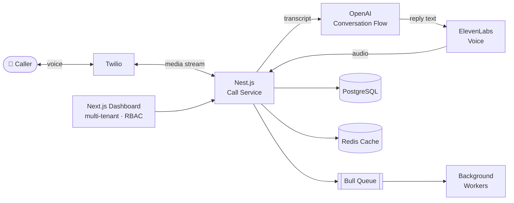
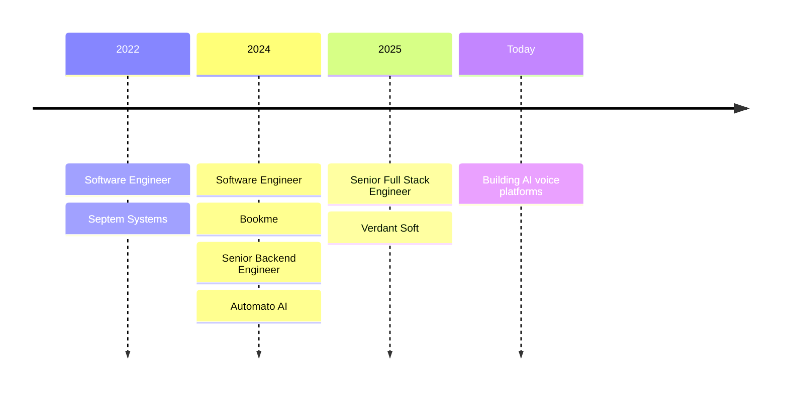

<div align="center">


<a href="https://portfolio-beta-taupe-39.vercel.app">
  
</a>

<br/>

<a href="https://portfolio-beta-taupe-39.vercel.app"></a>
<a href="https://linkedin.com/in/muhammad-ali-raza-711249177"></a>
<a href="mailto:aliwahlah777@gmail.com"></a>
<a href="https://github.com/muhammadalirazavs"></a>

<br/><br/>


<br/><br/>

<b>
<a href="#-about-me">About</a> •
<a href="#-tech-stack">Stack</a> •
<a href="#-how-i-build">How I Build</a> •
<a href="#-career-journey">Career</a> •
<a href="#-featured-projects">Projects</a> •
<a href="#-github-stats">Stats</a> •
<a href="#-lets-connect">Connect</a>
</b>

</div>

---

## 👋 About Me

<table>
<tr>
<td width="55%" valign="top">

I'm a **Full Stack Engineer** who loves the hard parts of the backend: the architecture, the integrations and the performance work that keep a product fast as it grows.

For **4+ years** I've shipped web and mobile products in booking, e-commerce, hosting and, most recently, **AI voice automation**.

- 🔭 Building **Hexa AI**, a multi-tenant AI calling platform
- 🌱 Going deeper into **LLM agents** & real-time voice
- 💬 Ask me about **Nest.js, microservices, queues, Stripe & Twilio**
- ⚡ Fun fact: I cut a production API's latency by **20%** with caching & query tuning

</td>
<td width="45%" valign="top">

```ts
// whoami.ts
const ali = {
  role: "Senior Full Stack Engineer",
  company: "Verdant Soft",
  based: "Lahore, PK 🇵🇰",
  degree: "BS CS · Namal University",
  loves: ["Clean APIs", "Fast queries"],
  stack: {
    back: ["Node", "Nest", "Express"],
    front: ["Next", "Nuxt", "React", "Vue"],
    ai: ["OpenAI", "ElevenLabs", "Twilio"],
  },
  coffee: Infinity,
};
```

</td>
</tr>
</table>

---

## 🧰 Tech Stack

<div align="center">

| | |
|:--:|:--|
| **Languages** |  |
| **Frontend** |  |
| **Backend** |  |
| **Databases** |  |
| **Cloud & Tools** |  |


<sub><b>Practices:</b> REST APIs · Microservices · CI/CD · Unit Testing · Agile/Scrum</sub>

</div>

---

## 🧩 How I Build

<sub>A simplified look at the architecture behind <b>Hexa AI</b>, the multi-tenant AI calling platform I'm building.</sub>



---

## 🧭 Career Journey



<details>
<summary><b>🏢 Senior Full Stack Engineer · Verdant Soft, Lahore</b> · <i>Dec 2025 – Present</i></summary>
<br/>

- Building large-scale mobile and web applications for high concurrent traffic
- Integrated **ElevenLabs, Twilio and OpenAI** into an automated AI calling system

</details>

<details>
<summary><b>🤖 Senior Backend Engineer · Automato AI, Chicago (Remote)</b> · <i>Dec 2024 – Nov 2025</i></summary>
<br/>

- Architected **microservices** for an AI-powered Amazon optimization platform
- Integrated **Amazon SP API** and **OpenAI**; background processing with **Bull Queue**
- Reduced latency by **20%** through query optimization and caching

</details>

<details>
<summary><b>✈️ Software Engineer · Bookme, Lahore</b> · <i>Sept 2024 – Aug 2025</i></summary>
<br/>

- Built booking and reservation systems on **Node.js / Nest.js**
- Integrated **Stripe** for secure payment processing

</details>

<details>
<summary><b>🖥️ Software Engineer · Septem Systems, Lahore</b> · <i>May 2022 – Sept 2024</i></summary>
<br/>

- Led development of the **BionicWP** hosting-management platform
- Added **Redis** caching and **Stripe** payments
- Built reusable components that cut development time across projects

</details>

---

## 🚀 Featured Projects

<table>
<tr>
<td width="50%" valign="top">

### 📞 Hexa AI
<sub>2026 · ⭐ Flagship</sub>

Multi-tenant **AI calling platform** with inbound/outbound call handling, custom conversation flows and role-based access.

`Nest.js` `Next.js` `Twilio` `OpenAI` `ElevenLabs` `PostgreSQL`

</td>
<td width="50%" valign="top">

### 🎒 Nedjmati App
<sub>2026</sub>

Mobile **learning app for Grades 1–6** with interactive activities, progress tracking and a parent dashboard.

`React Native` `Firebase` `Node.js` `PostgreSQL`

</td>
</tr>
<tr>
<td width="50%" valign="top">

### 🛒 Automato AI
<sub>2025</sub>

AI-powered **Amazon product optimization** platform with automated content generation.

`Nest.js` `MongoDB` `OpenAI` `Rainforest API`

</td>
<td width="50%" valign="top">

### 🏢 Bookme SA Corporate Portal
<sub>2024</sub>

**Corporate booking system** with real-time features and secure APIs.

`Node.js` `Nest.js`

</td>
</tr>
</table>

<details>
<summary><b>➕ More projects</b></summary>
<br/>

| Project | What it does | Stack |
|:--|:--|:--|
| ✍️ **Terstal AI** <sub>2024</sub> | AI admin panel that automates content creation for dynamic web apps | OpenAI API |
| 🎤 **Smart Interview Coach** <sub>2024</sub> | Data management with location insights, real-time visualization and reporting | Google Maps API |
| 💬 **ListenAI App** <sub>2023</sub> | Mobile AI chat app with real-time messaging and subscription monetization | Mobile · AI |
| ✅ **Ready v3.0** <sub>2022</sub> | Project and task management with role-based access and progress monitoring | Full Stack |

</details>

---

## 📊 GitHub Stats

<table>
<tr>
<th width="50%">🧑‍💻 Personal · <a href="https://github.com/Aliraza777">@Aliraza777</a></th>
<th width="50%">🏢 Company · <a href="https://github.com/muhammadalirazavs">@muhammadalirazavs</a></th>
</tr>
<tr>
<td align="center">


</td>
<td align="center">


</td>
</tr>
</table>

---

## 🤝 Let's Connect

<div align="center">

I'm always up for a conversation about **scalable backends**, **AI-powered products** or a **full stack build** that needs shipping.

<a href="mailto:aliwahlah777@gmail.com"></a>
<a href="https://muhammad-ali-raza-dev.vercel.app/"></a>

<br/><br/>

<i>⭐ Thanks for stopping by. Have a great day!</i>


</div>
